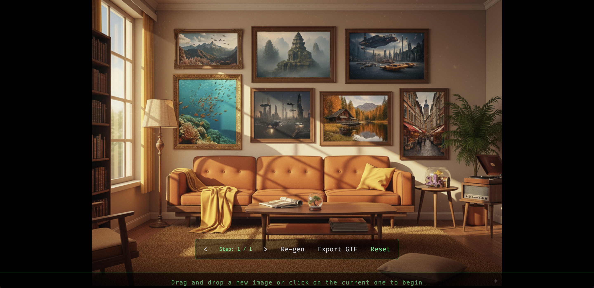
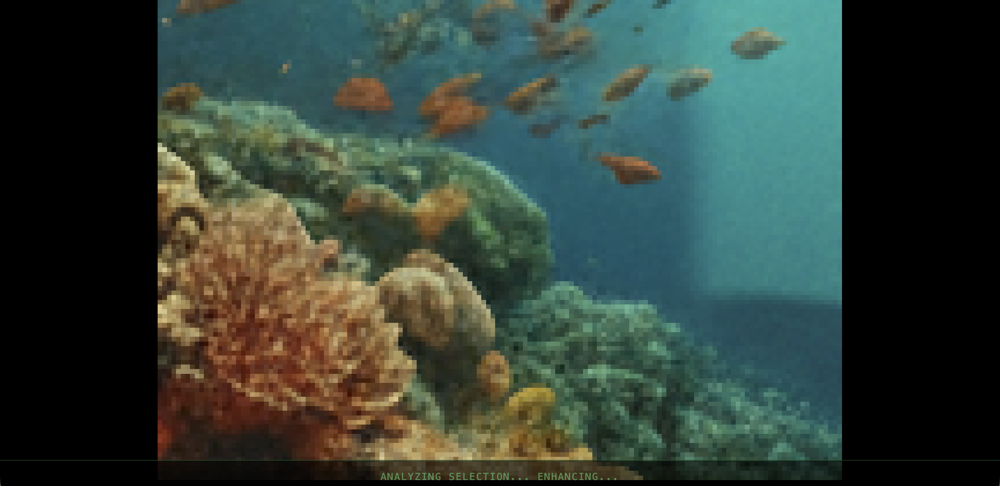
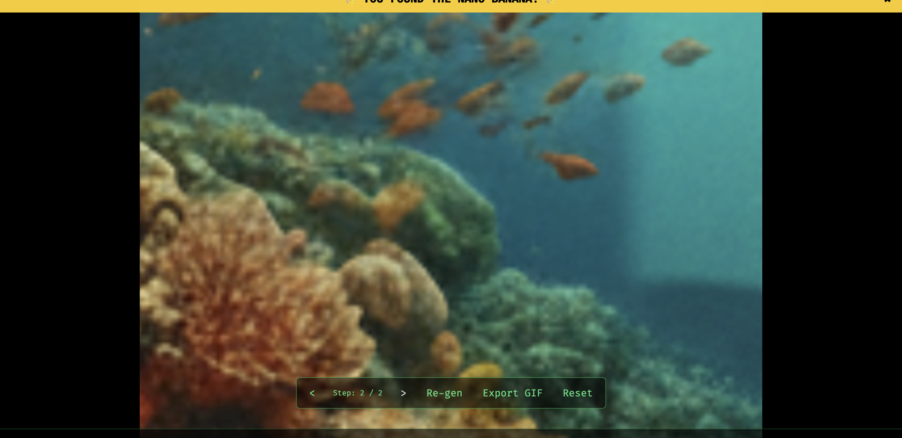

# Enhance!

> **Attribution:** This is [Google's "ENHANCE!" starter app](https://aistudio.google.com/) from AI Studio, exported and patched to run locally. I didn't build this — Google did. This repo exists to document the process of getting an AI Studio export working on a local machine.

The CSI "zoom and enhance" meme, but it actually works. Click any region of an image and Gemini generates high-resolution detail for it. Keep clicking to zoom deeper — each enhancement becomes the canvas for the next.





## What This Repo Is

A local-run exploration of Google's AI Studio starter app. The export from AI Studio doesn't run out of the box — it ships with CDN import maps, inline Tailwind, and hardcoded env vars that Vite can't resolve. This repo documents what it took to get it working:

- Migrated Tailwind from CDN to npm (done by automated fix pass)
- Removed import maps and pointed dependencies at `node_modules`
- Moved API key to proper Vite env vars (`import.meta.env`)
- Fixed a leftover `unpkg.com` import for `gifenc`
- Updated the deprecated `gemini-2.5-flash-image-preview` model to the stable `gemini-2.5-flash-image`

## Quick Start

> Requires Node.js 18+ and a [Gemini API key](https://aistudio.google.com/apikey)

```bash
git clone https://github.com/AndrewVoirol/enhance.git
cd enhance
npm install
```

Add your API key to `.env.local`:
```
VITE_GEMINI_API_KEY=your_key_here
```

```bash
npm run dev
```

## How It Works

Click anywhere on the image. The app crops your selection, sends it to Gemini to understand what it's looking at, then asks Gemini to generate a high-res version with invented detail. A pixel-dissolve animation reveals the result, which replaces the current view — so you can keep zooming forever.

Undo/redo your zoom history, regenerate any step, or export the whole journey as an animated GIF.

There's also a hidden nano banana 🍌 easter egg. The AI occasionally sneaks one into enhanced images.

## Tech Stack

| Layer | Tech |
|---|---|
| Framework | React 19 |
| Build | Vite 6 |
| Styling | Tailwind CSS 3 |
| AI | Gemini 2.5 Flash (describe) + Gemini 2.5 Flash Image (enhance) |
| GIF Export | gifenc |
| Language | TypeScript |

## Credit

All application code is by Google, exported from their [AI Studio](https://aistudio.google.com/) starter apps. The modifications in this repo are limited to build/config fixes required to run locally. Licensed under Apache 2.0 per the original source headers.

## License

[Apache 2.0](LICENSE)
